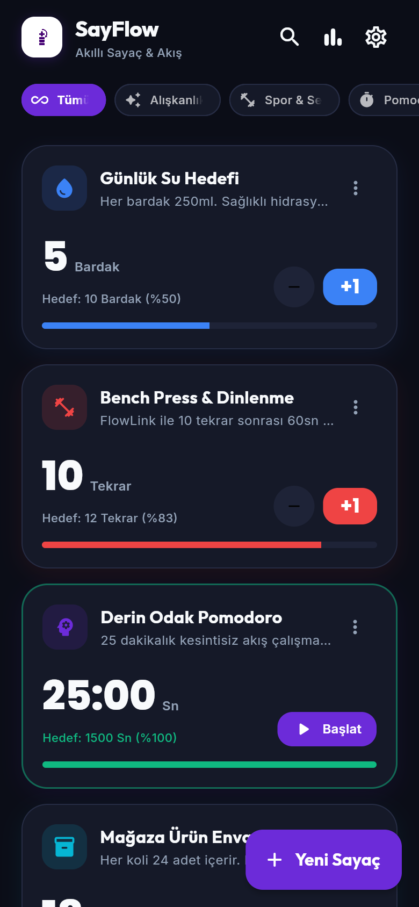
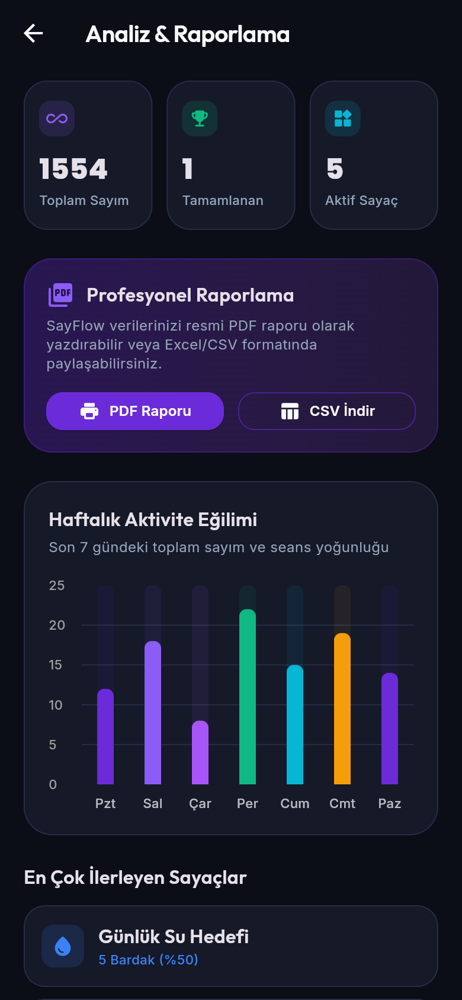

<p align="center"><a href="https://oidioom.com"></a></p>

<h1 align="center">🔢 SayFlow</h1>

<p align="center"><b>Smart counters & flow — count anything, track progress, stay focused.</b></p>

<p align="center">
  
  
  
  
  
  
  <a href="https://oidioom.com"></a>
</p>

<p align="center"><a href="#-english">🇬🇧 English</a> · <a href="#-türkçe">🇹🇷 Türkçe</a></p>

---

## 🇬🇧 English

SayFlow is a multi-purpose tally app: water goals, workout reps, Pomodoro focus sessions, stock counting and more. Group counters into categories, see your history in charts and export your data.

> [!NOTE]
> This is a **showcase repository**. SayFlow is closed-source; this repo contains the project overview, screenshots and a few short code excerpts.

## ✨ Features

- ➕ Counters, timers and Pomodoro in one card system
- 🔗 FlowLink: automatic rest/focus after N reps
- 🗂️ Categories, favorites and archive
- 📈 Analytics charts and history
- 📤 Export to PDF / CSV, print and share
- 🧘 Zen Desk focus mode, themes and haptics

## 📸 Screenshots

<table>
<tr><td align="center"><br><sub>Counters</sub></td><td align="center"><br><sub>Analytics</sub></td></tr>
</table>

## 🧩 Code Showcase

A few real, short excerpts from the codebase — each with a note on what it does and where it is used. See the [`showcase/`](showcase) folder.

**[`counter_progress.dart`](showcase/counter_progress.dart)** — Progress of a counter toward its target, clamped between 0 and 1. _Feeds the progress bar at the bottom of every counter card._

```dart
double get progress {
  if (targetValue <= 0) return 0.0;
  final p = currentValue / targetValue;
  return p.clamp(0.0, 1.0);
}

bool get isTargetReached => targetValue > 0 && currentValue >= targetValue;
```

**[`counter_type.dart`](showcase/counter_type.dart)** — The three counter modes SayFlow supports. _Chosen in the 'New Counter' sheet._

```dart
enum CounterType { count, timer, pomodoro }

double get calculatedTotalValue => currentValue * multiplier;
```

## 🛠️ Built With

Flutter · Dart · Provider · fl_chart · pdf/printing · shared_preferences

## 📄 License

© 2026 Oidioom / Tarek Sharabaty. All rights reserved. See [LICENSE](LICENSE).

---

## 🇹🇷 Türkçe

**Akıllı sayaç ve akış — her şeyi sayın, ilerlemeyi takip edin, odakta kalın.**

SayFlow çok amaçlı bir sayaç uygulamasıdır: su hedefi, antrenman tekrarları, Pomodoro odak seansları, stok sayımı ve daha fazlası. Sayaçları kategorilere ayırın, geçmişinizi grafiklerle görün ve verilerinizi dışa aktarın.

> [!NOTE]
> Bu bir **vitrin (showcase) deposudur**. SayFlow kapalı kaynaklıdır; bu depoda proje tanıtımı, ekran görüntüleri ve birkaç kısa kod alıntısı bulunur.

## ✨ Özellikler

- ➕ Sayaç, zamanlayıcı ve Pomodoro tek kart sisteminde
- 🔗 FlowLink: N tekrardan sonra otomatik dinlenme/odak
- 🗂️ Kategoriler, favoriler ve arşiv
- 📈 Analiz grafikleri ve geçmiş
- 📤 PDF / CSV dışa aktarma, yazdırma ve paylaşma
- 🧘 Zen Masası odak modu, temalar ve titreşim

## 🧩 Kod Vitrini

Kod tabanından kısa ve gerçek alıntılar; kodlar yukarıdaki İngilizce bölümde gösterilmiştir. Hepsi [`showcase/`](showcase) klasöründe:

- **[`counter_progress.dart`](showcase/counter_progress.dart)** — Bir sayacın hedefe ilerlemesini 0 ile 1 arasında hesaplar. _Her sayaç kartının altındaki ilerleme çubuğunu besler._

- **[`counter_type.dart`](showcase/counter_type.dart)** — SayFlow'un desteklediği üç sayaç modu. _'Yeni Sayaç' penceresinde seçilir._

## 🛠️ Kullanılan Teknolojiler

Flutter · Dart · Provider · fl_chart · pdf/printing · shared_preferences

## 📄 Lisans

© 2026 Oidioom / Tarek Sharabaty. Tüm hakları saklıdır. Ayrıntılar için [LICENSE](LICENSE).

---

<p align="center"><a href="https://oidioom.com"></a></p>
<p align="center"><b>by Oidioom — Tarek Sharabaty</b><br>
<a href="https://oidioom.com">oidioom.com</a> · <a href="https://github.com/tariksharabaty">GitHub</a> · <a href="https://modrinth.com/organization/oidioomstudio">Modrinth</a> · <a href="https://gear.oidioom.com">Gear</a> · <a href="https://www.instagram.com/oidioom">Instagram</a></p>
